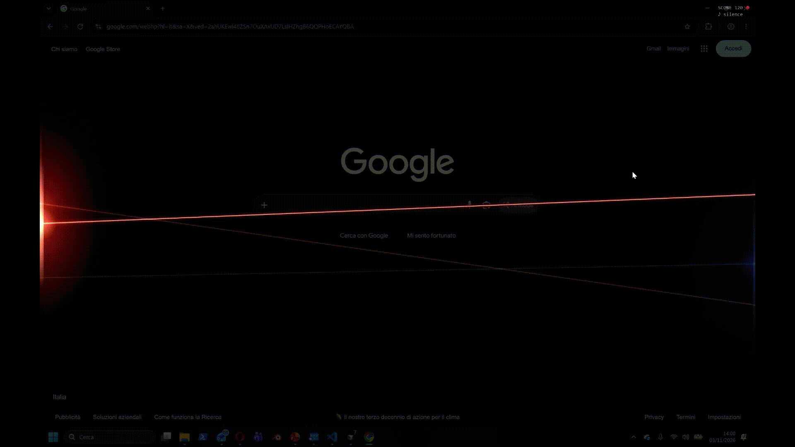
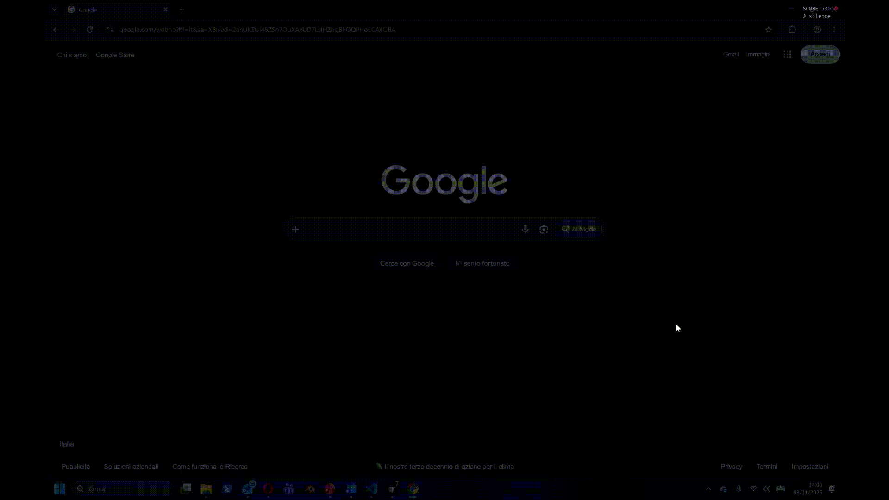

# Edge Flash

Turn your keyboard into concert lights while you listen to music.



Edge Flash is a transparent, click-through overlay for Windows that sits on top of everything. Switch it on and every key fires a flash or a laser from the edge of the screen. It also listens to what your PC is playing, finds the beat, and tells you if you are tapping in time, rhythm-game style.

## Features

- **Lights mapped to the shape of your keyboard** (Italian QWERTY):
  - **direction**: where a key sits relative to the center of the keyboard is where its light appears around the screen, a full 360°. `Q` lights the upper left, `ù` the right side, `B` the bottom center
  - **intensity**: keys near the center (`G H T Y`) fire strong, sharp flashes with lasers; moving toward the edge of the keyboard (`\ 1 Q A < - ù`) they fade into soft, slow, wide glows
  - colors blend smoothly around the screen
  - **Space is the special**: a full-screen flash, a shockwave from the center and lasers from every edge
- **Lasers** that cross the screen, with Space and Enter opening a 7-beam fan
- **Screen dimming** while active, so the colors pop
- **Beat detection** on the audio your PC is playing (Spotify, YouTube, anything), no microphone
- **Timing judgements**: PERFECT / GREAT / GOOD / ALMOST / MISS, with off-beat taps accepted
- **Energy matching**: the song's loudness is measured against its own dynamics. Soft lights in quiet parts and strong lights in loud parts score 1.5×. Fire the special on a drop for a 1000-point **DROP!**, waste it in a quiet part and you get **SAVE IT!**
- **Automatic latency calibration**, Bluetooth headphones included
- **Session score** with combo multiplier, a random end-of-session comment and a saved personal best

  

- **Two display modes**: *Quiet* keeps score and analysis small in the top-right corner. *Loud* puts a big score in the middle of the screen that counts up and grows as you play, with a column of PERFECT / GREAT / DROP! judgements stacking above it and the analysis in the top-left corner
- 4 color palettes

## Controls

| Shortcut | Action |
| --- | --- |
| `Ctrl+Alt+F` | Start / end a session |
| `Esc` | End the session |
| `Ctrl+Alt+D` | Cycle screen dimming (off, light, medium, strong) |
| `Ctrl+Alt+L` | Cycle lasers (off, with flashes, lasers only) |
| `Ctrl+Alt+M` | Switch between Quiet and Loud mode |

The tray icon menu has the display mode, palettes, dimming, lasers, rendering, the beat analysis toggle and latency recalibration. Settings and your best score are remembered.

While a session is off, Edge Flash only listens for its three shortcuts and everything else reaches your apps as usual. When you start a session it takes keyboard focus, so your keys trigger lights instead of being typed into your work. Ending the session gives focus back to the window you were using. Clicking another window or pressing Alt+Tab ends the session too.

## Install

Requires Windows and [Python 3](https://www.python.org/downloads/).

1. Download or clone this repository.
2. Double-click `Avvia Edge Flash.bat`.

The first run creates a local virtual environment and installs the dependencies, then Edge Flash starts in the tray. Later runs start it directly.

Manual install:

```
python -m venv .venv
.venv\Scripts\pip install -r requirements.txt
.venv\Scripts\pythonw edge_flash.py
```

## Privacy

Edge Flash does not hook or monitor your keyboard.

- The shortcuts are registered with [`RegisterHotKey`](https://learn.microsoft.com/windows/win32/api/winuser/nf-winuser-registerhotkey), the standard Windows API for global hotkeys. Windows only notifies the app when those exact combinations are pressed.
- During a session, a tiny invisible window takes keyboard focus and receives keys like any foreground app. It never sees what you type in other windows.
- Audio is captured from your PC's output (WASAPI loopback, no microphone), analyzed in memory and never recorded.
- Nothing is stored or sent anywhere, apart from your settings and best score in the Windows registry.

## Rendering

Edge Flash draws on the GPU. The overlay is a transparent OpenGL window composited by Windows (DWM), the same technique game overlays use. Every effect is a sprite prepared once and uploaded to the GPU at startup (about 14 MB of textures), so during a session the GPU only scales, rotates and fades them: no per-frame texture uploads and no readbacks. When nothing is animating, Edge Flash stops rendering entirely.

If your graphics driver shows a black background instead of a transparent one, switch to **Rendering → CPU** from the tray menu. It works everywhere but is heavier with many lasers.

## How the beat detection works

Edge Flash captures the system output through WASAPI loopback and computes a spectral flux onset detector on two bands (kick drum and everything else). From the last 10 seconds of onsets it estimates the tempo between 70 and 180 BPM and the beat phase, using the strongest low-frequency hits to find the downbeat. Your tap times are compared with that grid after subtracting your measured headphone latency.

It works best with music that has a clear kick drum. Quiet acoustic tracks may not lock.

## License

MIT
